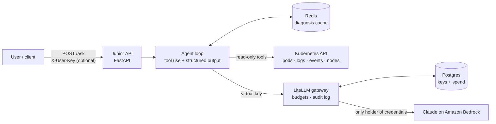

# Junior: an AI on-call engineer for Kubernetes

**Ask a question in plain English. Get a structured, evidence-based diagnosis of what's broken in your cluster, and why.**

Junior is a read-only Kubernetes troubleshooting agent built **directly on the Anthropic Messages API**, without LangChain or agent frameworks. The agent loop, tool dispatch, caching, error handling and evaluation are all hand-written, so every behavior is visible and testable.

```text
POST /ask  {"question": "Are there any issues in the sandbox namespace?"}
```

Example response (trimmed):

```json
{
  "diagnosis": [
    { "kind": "Pod", "name": "bad-image", "container": "web", "category": "k8s_issue",
      "summary": "Image pull fails: tag nginx:9.9.9-does-not-exist does not exist in the registry (ImagePullBackOff). Fix the image reference." },
    { "kind": "ReplicaSet", "name": "billing-9bdfc5cbc", "container": null, "category": "k8s_issue",
      "summary": "Cannot create pods: ServiceAccount 'billing-sa' does not exist (FailedCreate). Create it or fix the reference." },
    { "kind": "PersistentVolumeClaim", "name": "reports-data", "container": null, "category": "k8s_issue",
      "summary": "Provisioning fails: StorageClass 'fast-ssd' does not exist (ProvisioningFailed)." }
  ],
  "summary": "The sandbox namespace has 1 failing pod and 2 non-pod problems: a missing ServiceAccount and a missing StorageClass.",
  "error": null,
  "token_usage": { "input": 6, "output": 1080, "creation_cache": 1820, "read_cache": 6058 }
}
```

---

## Highlights

| | |
|---|---|
| **Hand-built agent loop** | Tool use, multi-round reasoning and structured output on the raw Messages API. No framework hiding the mechanics. |
| **Structured output, not prose** | The model must finish by calling a `submit_diagnosis` tool whose JSON schema *is* the API contract (`kind`, `name`, `container`, `category`, `summary`). |
| **Read-only by design** | Tools only `get`/`list`, and the manifests ship a read-only ClusterRole (`get`/`list`/`watch`). |
| **Beyond pods** | Combines pod status, logs, Warning events and node conditions, so it catches problems that never show up as a failing pod (missing ServiceAccount, StorageClass, HPA target...). |
| **Two caching layers** | A Redis **diagnosis cache** (keys versioned by prompt + tool-schema hash) and Anthropic **prompt caching**, which cut input-token cost by **~60–75%** in measured runs. |
| **Fails loudly, never "falsely healthy"** | A failed tool or model call returns `503` with the real error instead of an empty `200`. The model is told tool errors are not findings. |
| **LLM gateway with per-user budgets** | All model traffic goes through a **LiteLLM** proxy. Junior holds no provider credentials. Every caller has a virtual key with a budget, and every request is logged as *who / model / tokens / cost*. |
| **Evaluated, not vibe-checked** | A task-fidelity eval harness scores each diagnosis against expected `(kind, name, category)` and status codes. The scorer itself is unit-tested. |

---

## Architecture



### How a request flows

1. **`/ask`** receives a natural-language question (and optionally the caller's own gateway key).
2. The **agent loop** sends the question, system prompt and tool definitions to Claude.
3. Claude picks tools. Junior **executes them against the cluster** and returns the results. This repeats for up to 6 rounds.
4. Tool results are checked against the **diagnosis cache**. Known problems come back with their cached diagnosis, so the model doesn't re-investigate them.
5. Claude finishes by calling **`submit_diagnosis`**. Junior validates it, stores new diagnoses in the cache, and returns JSON.

### Tools

| Tool | What it returns |
|---|---|
| `get_pods_status` | One entry per failing or recently-crashed container: reason, message, owner, referenced ConfigMaps/Secrets. Deduplicates replicas by owner. |
| `get_pods_logs` | Current or previous logs of a container, for crashes the status can't explain. |
| `get_events` | Warning events for **any** kind of object, with the container parsed from `fieldPath`. |
| `get_nodes_status` | Every node: readiness, pressure conditions, taints, cordon state. |
| `submit_diagnosis` | Not executed. It's the structured-output channel that ends the loop. |

---

## Engineering decisions worth reading

- **Why no framework?** To own the loop: retries, error classification, caching and stopping rules are explicit code, not framework defaults. A port to LangGraph is planned. The eval harness exists so that port can be proven equivalent.
- **"I couldn't look" ≠ "nothing is wrong".** An early version returned `200` with an empty diagnosis when the cluster was unreachable, which is indistinguishable from "healthy". Tool failures are now tracked in the loop, marked with `is_error` for the model, and surfaced as `503`. Model or gateway failures (bad credentials, budget exceeded) are handled the same way.
- **Cache invalidation by construction.** The cache key includes a hash of the system prompt, tool schemas and model. Changing any of them invalidates stale diagnoses automatically.
- **Gateway, not provider keys.** The provider credential lives only in the gateway. Junior, scripts and developer tools all authenticate with per-person virtual keys, so budgets and the audit trail work per user, and nothing can bypass them.

---

## Quick start (local, with kind)

**Prerequisites:** Docker, [kind](https://kind.sigs.k8s.io/), `kubectl`, and Bedrock access to Claude Haiku in `us-east-1`.

```bash
# 1. A local cluster, and a kubeconfig the containers can use
kind create cluster --name dev
mkdir -p k8s-object && kind get kubeconfig --name dev --internal > k8s-object/config

# 2. Break things on purpose (deliberately broken workloads)
kubectl apply -f scenarios/

# 3. Configure secrets
cp .env.example .env        # then fill in LITELLM_MASTER_KEY, LITELLM_DB_PASSWORD and a Bedrock credential

# 4. Start the gateway and create Junior's key (with a budget)
docker compose up -d litellm
curl -s -X POST http://127.0.0.1:4000/key/generate \
  -H "Authorization: Bearer $(grep LITELLM_MASTER_KEY .env | cut -d= -f2)" \
  -H 'Content-Type: application/json' \
  -d '{"key_alias":"junior","models":["claude-haiku-4-5"],"max_budget":5,"budget_duration":"1d"}'
# put the returned "key" into .env as LITELLM_API_KEY

# 5. Start Junior and ask
docker compose up -d
curl -s http://127.0.0.1:8000/ask -H 'Content-Type: application/json' \
  -d '{"question": "Are there any issues in the sandbox namespace?"}'
```

Per-user calls: add `-H "X-User-Key: <that user's gateway key>"` to the request. Spend and budget are then tracked on that user's key.

Audit trail: `docker compose logs -f litellm | grep '\[who\]'`

```text
[who] status=ok     key=alice model=claude-haiku-4-5 tokens=4054 cost=$0.006254
[who] status=failed key=bob   model=claude-haiku-4-5 reason=Budget has been exceeded! ...
```

---

## Evaluation

```bash
python -m eval.task_fidelity      # runs every case against the live API
python -m pytest -q tests/        # unit tests for the scorer
```

Each case in `eval/cases.yaml` is a question plus the expected diagnoses and HTTP status. The runner scores every case as correct / wrong category / missed / false positive, prints a pass rate, and exits non-zero below the threshold, so it's ready for CI.

`scenarios/` contains 18 deliberately broken workloads (bad image, missing Secret key, OOMKilled, crash loops, failing init containers, unschedulable pods, missing StorageClass, prompt injection hidden in logs...) used as the eval fixture.

---

## Project layout

```text
junior/
  agent.py          agent loop, tool dispatch, caching, error handling
  api.py            FastAPI: /ask, /health
  prompts.py        system prompt
  models.py         request/response contract (Pydantic)
  cache.py          Redis diagnosis cache
  tools/            Kubernetes tools, grouped by domain (workloads, events, cluster) + schemas
litellm/            gateway config + per-request audit logger
eval/               task-fidelity eval harness and cases
tests/              unit tests
scenarios/          broken workloads for testing and evals
manifests/          Kubernetes deployment + read-only RBAC
```

## Stack

Python · Anthropic Messages API (Claude on Amazon Bedrock) · FastAPI · Pydantic · Kubernetes Python client · Redis · LiteLLM · PostgreSQL · Docker Compose · kind

---

## Roadmap

- [x] Agent loop with tool use and structured output
- [x] Pods, logs, events and nodes coverage
- [x] Diagnosis cache + prompt caching
- [x] Honest failure handling (503 instead of a silent empty result)
- [x] LLM gateway: per-user keys, budgets, audit log
- [x] Task-fidelity eval harness
- [ ] Detection gaps: last state of crash-looping containers (OOMKilled), init containers
- [ ] Services without endpoints, stuck rollouts
- [ ] `404` for unknown namespaces (vs `503` for an unreachable cluster)
- [ ] GitHub integration: trace application crashes to the code
- [ ] Port to LangGraph, with evals proving parity
- [ ] Web UI with multi-turn sessions
